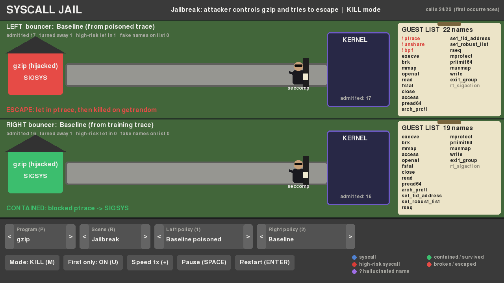

# Can Local LLMs Write Syscall Sandboxes?

Operating Systems L4 term project. Instructor: Zafar Iqbal.
Areesha Kashif, Alishbah Saleem Kath, Noor E Hira.

**Research question.** Can local LLMs synthesize seccomp-style syscall policies from strace traces of normal
program runs, and how does the result compare with a deterministic trace-to-profile baseline in attack surface
removed versus legitimate behaviour broken?

**In plain words.** Every program asks the kernel for things through system calls. A seccomp filter is a
bouncer with a guest list: any syscall not on the list kills the program. We record which syscalls programs
make (strace), build guest lists two ways, and run the programs behind those lists for real. We then measure
what breaks and what dangerous calls get through.
- The **baseline** copies exactly what the recording shows.
- The **LLM policies** come from local models in Ollama.

OS elements covered: **Security** (least privilege, privilege-escalation prevention), **I/O** (system-call
interception with seccomp and strace) and **Concurrency** (multithreaded test program, thread syscalls).



---

## 1. What runs where

| Step | Needs | Who |
|---|---|---|
| Build, tracing, baseline, enforcement, containment | **Linux** (Ubuntu 22.04/24.04, or WSL2), gcc, strace | Person A |
| LLM policy generation | Ollama + Python (Windows or Linux), 16 GB RAM for the 8B model | Persons B and A |
| Analysis, figures, visualizer | Python on any OS | Person C |

seccomp and strace are Linux kernel features, so those steps cannot run on Windows itself. Everything else
is plain Python and runs on Windows.

## 2. Setup

### Ubuntu (Person A)
```bash
git clone <repo-url> && cd syscall-sandboxes
bash scripts/setup_ubuntu.sh        # apt packages, venv, pip install, make, syscall table
source .venv/bin/activate           # in every new terminal
```

### Windows (Persons B and C)
Install Python 3.10+ (tick "Add to PATH") and Git. Then in PowerShell:
```powershell
git clone <repo-url>; cd syscall-sandboxes
py -m venv .venv
.venv\Scripts\activate
pip install -r requirements.txt
```
Person B also installs Ollama for Windows (https://ollama.com/download) and runs:
```powershell
ollama pull llama3.2:3b
ollama pull llama3.1:8b
```

### Try it immediately, before real data exists
```bash
python visualizer/syscall_jail.py --examples        # the demo, using examples/ data
python harness/prompts.py gzip c --examples         # see exactly what the LLM is asked
```

## 3. Running the experiment, in order

| # | Command | Machine | Output |
|---|---|---|---|
| 1 | `make` | Linux | `programs/bin/*`, `enforce/bin/seccomp_launcher` |
| 2 | `python3 tracing/record_traces.py` | Linux | `data/<program>/traces/{training,heldout,poisoned}.strace`, summaries, probe trace |
| 3 | `python3 tracing/make_baseline.py` | any | `policies/baseline/<program>/baseline__{training,poisoned}.json` |
| 4 | `python harness/timing_test.py` | Ollama machine | time per generation → choose `--repeats` |
| 5 | `python harness/generate_policies.py --models llama3.1:8b` (B) and `--models llama3.2:3b` (A) | Ollama machines | `policies/llm/<program>/*.json`, `results/generation_log.csv` |
| 6 | `python3 enforce/run_enforcement.py` | Linux | `results/enforcement.csv` (real seccomp pass/fail and blocked syscall) |
| 7 | `python3 enforce/run_containment.py` | Linux | `results/containment.csv` (probe validation) |
| 8 | `python analysis/evaluate_policies.py` | any | `results/policy_metrics.csv` |
| 9 | `python analysis/make_figures.py` | any | `results/figures/fig1..fig5.png`, `results/summary.md` |
| 10 | `python visualizer/syscall_jail.py` | any | interactive demo |

Steps 1–3 and 6–9 in one go on Linux: `bash scripts/run_pipeline.sh`.

Steps 5 and 6 **resume**: re-running skips finished work, so an interrupted overnight run can just be
started again with the same command.

Testing the whole pipeline without Ollama:
```bash
python harness/generate_policies.py --backend fake --repeats 1
```
Fake policies are labelled `TEST-FAKE` and are excluded from analysis unless you pass `--include-fake`.
**Delete them before the real runs.**

## 4. Repository layout and what every file does

```
config/        experiment settings (programs, syscall table, risk list, descriptions)
sandboxlab/    shared Python library used by every step
programs/      our own C test programs + workloads
tracing/       record traces, build baseline                         (Person A)
enforce/       seccomp launcher + real enforcement + containment     (Person A)
harness/       LLM prompts and generation with Ollama                (Person B)
analysis/      metrics, figures, summary                             (Person C)
visualizer/    Syscall Jail demo                                     (Person C)
data/          recorded traces           (generated, committed)
policies/      baseline + LLM policies   (generated, committed)
results/       csv results + figures     (generated, committed)
examples/      small sample data for testing on day 1 (NOT results)
docs/          methodology, work division, report draft, viva notes
scripts/       Ubuntu setup and full pipeline
```

### config/
| File | Purpose |
|---|---|
| `programs.json` | The 6 test programs. For each: description, setup commands, training and held-out command, and a correctness check. The poisoned run = training run + `LD_PRELOAD=poison.so`. Add a program here to include it everywhere. |
| `syscalls_x86_64.json` | Syscall name → number (373 entries, from `asm/unistd_64.h`). Used to detect hallucinated names and to build the filter. |
| `high_risk.txt` | 32 high-risk syscalls with the reason for each (ptrace, mount, unshare, bpf, io_uring, ...). |
| `syscall_descriptions.json` | One-line meaning of 189 common syscalls (others show "No description available"); used in prompt style c, tooltips and reports. |

### sandboxlab/ (shared library)
| File | Purpose |
|---|---|
| `paths.py` | All folder locations, relative to the repo, so the same code works on Windows and Ubuntu. |
| `syscalls.py` | Loads the table, risk list and descriptions; `classify()` splits a name list into valid / hallucinated / high-risk / duplicates. |
| `strace_parser.py` | Parses `strace -f` lines (pids, unfinished/resumed calls, signals) into events and `{syscall: count}` summaries; finds the blocked syscall in TRAP-mode traces. |
| `policy.py` | Policy JSON format, loading (also plain lists and Docker profiles), JSON extraction from LLM text, names → numbers file for the launcher. |
| `replay.py` | Replays a trace against a policy: where would the program die, what high-risk calls get in. Used by analysis and the visualizer. |
| `workload.py` | **Linux only.** Runs one program run in a fresh scratch directory, plainly, under strace, or under the launcher; runs the HTTP client for mini_httpd; checks correctness. |

### programs/
| File | Purpose |
|---|---|
| `src/worker.c` | Multithreaded worker (`worker 0` vs `worker 4`): concurrency syscalls. |
| `src/mini_httpd.c` | One-request HTTP server: `sendfile` path (training) vs directory listing (held-out). |
| `src/escape_probe.c` | Harmless jailbreak probe: 10 dangerous syscalls with invalid arguments, prints BLOCKED or REACHED_KERNEL each. |
| `src/poison.c` | `LD_PRELOAD` library injecting ptrace/unshare/bpf calls, to create the poisoned trace. |
| `workloads/sqlite_insert.sql`, `sqlite_query.sql` | sqlite3 training and held-out workloads. |
| `Makefile` | Builds the above into `programs/bin/`. |

gzip, sqlite3, cp and tar are the system's own binaries.

### tracing/ (Person A)
| File | Purpose |
|---|---|
| `record_traces.py` | Sanity-runs each program, then records training/held-out/poisoned traces with `strace -f`, plus summaries, metadata (kernel, glibc, strace version) and the probe trace. |
| `make_baseline.py` | Baseline policies: exactly the syscalls in the trace, default deny. |
| `gen_syscall_table.py` | Regenerates `config/syscalls_x86_64.json` from the machine's kernel headers. |

### enforce/ (Person A)
| File | Purpose |
|---|---|
| `src/seccomp_launcher.c` | The bouncer: builds the BPF filter (arch check, x32 check, allow-list, default action), sets NO_NEW_PRIVS, installs seccomp, `exec`s the program. Modes: kill / trap / log / errno:N. |
| `run_enforcement.py` | Runs every program under every policy on both runs. On SIGSYS, re-runs in TRAP mode under strace to name the blocked syscall. Writes `results/enforcement.csv`. |
| `run_containment.py` | Runs the escape probe under every policy (errno mode) and checks each outcome matches the policy. Writes `results/containment.csv`. |

### harness/ (Person B)
| File | Purpose |
|---|---|
| `prompts.py` | System prompt and the three styles: (a) name only, (b) trace summary, (c) summary + descriptions. Run directly to preview a prompt. |
| `ollama_client.py` | Standard-library client for Ollama `/api/chat` (temperature, seed, `num_ctx`, timing). |
| `generate_policies.py` | Runs the generation grid, saves one JSON per generation (raw output, extracted list, validity, timing). Resumable. |
| `timing_test.py` | Measures one generation per model and estimates the full grid's time. |
| `fake_backend.py` | Fake model for pipeline tests only (labelled TEST-FAKE, never reported). |

### analysis/ (Person C)
| File | Purpose |
|---|---|
| `replay_check.py` | One trace + one policy → readable verdict (e.g. "KILLED at getrandom"). |
| `evaluate_policies.py` | Per-policy metrics → `results/policy_metrics.csv`. |
| `make_figures.py` | Figures 1–5 + `results/summary.md` (main table, forgotten syscalls, replay-vs-real agreement, poisoned table, H3 check, containment). |

### visualizer/ (Person C)
| File | Purpose |
|---|---|
| `syscall_jail.py` | Pygame demo. Two bouncers replay the same real trace against two real policies. Scenes: training, held-out, poisoned, jailbreak probe. Hover any syscall for a tooltip. Keys: P program, R scene, 1/2 policies, M kill/errno, U first-occurrence, +/- speed, SPACE pause, ENTER restart. `--screenshot file.png` renders headless. |

### docs/
| File | Purpose |
|---|---|
| `METHODOLOGY.md` | Every methodological decision (D1–D14) and its reason. |
| `WORK_DIVISION.md` | Who owns which files, step-by-step tasks per person, day plan. |
| `REPORT_DRAFT.md` | Report skeleton with background, related work and method written. |
| `VIVA_NOTES.md` | 20 likely viva questions with answers. |

## 5. Outputs explained

| File | Columns / content |
|---|---|
| `data/<p>/summary_<run>.json` | total calls, unique syscalls, processes/threads, `{syscall: count}` |
| `policies/**.json` | `program, source, prompt, repeat, trace_used, allow, json_valid, extraction, raw_output` (+ timing for LLMs) |
| `results/enforcement.csv` | one row per (policy, run): `passed`, `signal` (SIGSYS = killed by seccomp), `blocked_syscall` |
| `results/containment.csv` | one row per (policy, dangerous syscall): `policy_allows`, `outcome`, `matches` |
| `results/policy_metrics.csv` | per policy: `n_allowed`, `n_high_risk`, `n_hallucinated`, `poison_kept`, replay predictions, `missing_heldout`, `speculative` |
| `results/summary.md` | all report numbers in tables |

## 6. Safety
- The escape probe and the poison library only make syscalls with invalid arguments. They change nothing even when not blocked.
- All runs happen in temporary scratch directories, which are deleted afterwards.
- A syscall filter is one defence layer, not complete security.

## 7. Use of AI
As allowed by the course policy, AI tools were used for brainstorming, coding and writing.
All three members can explain every component (see `docs/VIVA_NOTES.md`).
